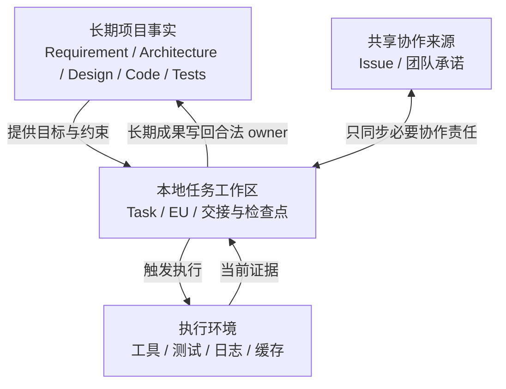
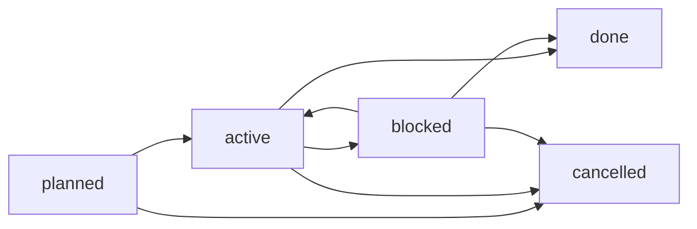
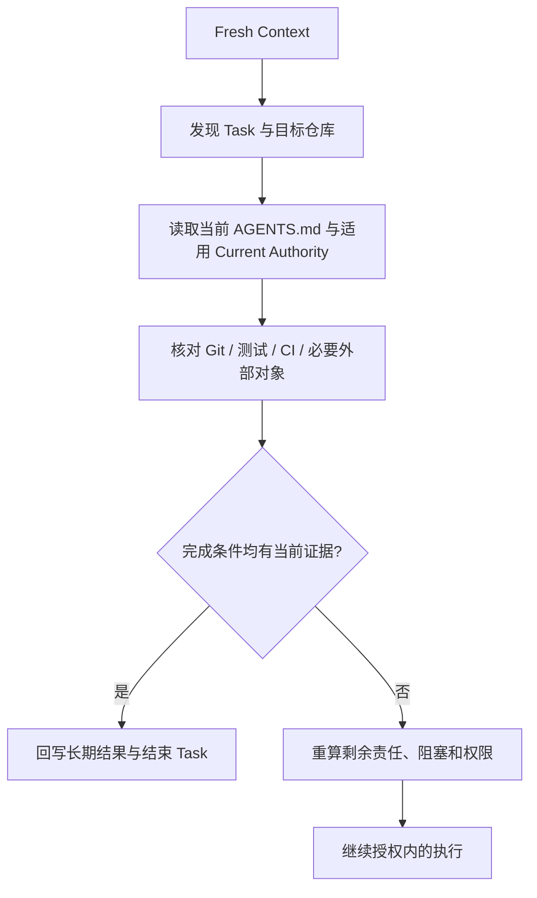

# 本地任务工作区：轻量组织、恢复与生命周期

本文讨论如何为 AI 驱动软件开发建立**够用即可**的本地任务管理机制，面向人和 AI 按需阅读。以下目录、状态和元数据均是可裁剪的 Consumer 方案示例，**不是** `agentic-dev` Skills 的强制输入契约，不要求所有 Consumer 创建 `work/`、任务数据库、Registry 或额外服务。最终规则与授权由 Consumer Repository Authority 决定。

## 1. 为什么要治理短生命周期任务

长任务可能跨会话、跨 Agent、跨人或跨仓库，聊天记录难以可靠恢复目标、依赖、真实进度和下一步；另一方面，永久提交 EU、临时计划、调试日志与运行快照又会稀释项目长期知识。管理目标是：**当前责任可发现、可恢复、可完成、可退出；本地 Work 删除后，长期项目依然可以继续演进。**



正式 Current Authority 表达项目长期应该是什么；Work 表达谁在做什么；运行时 Evidence 表达实际发生了什么。工作日志不会因为被版本控制而自动成为正式产品事实。

## 2. Task、EU、Handoff 并不等价

| 对象 | 主要责任 | 存储建议 |
| --- | --- | --- |
| Task（一般任务） | 目标、范围、状态、阻塞与下一步；计划、Bug、研究等都可成为来源 | 需要跨会话恢复或协调时才创建，通常临时 |
| Execution Unit（EU） | Fresh Context 中可独立理解、执行与验证的有界责任 | 按现有 `slice-work` 等 Skills 生成，Task 不必都有 EU |
| JIT Execution Plan | 当前 EU 的施工、验证步骤 | 通常随执行结束退出 |
| Handoff（交接） | 将已有责任和恢复线索交给接手者 | 生命周期事件，不因每次交接就创建新 Task |
| Issue / 共享任务 | 多人承诺、分工与共享阻塞 | 由团队已有共享渠道承担，不复制完整本地执行日志 |
| 长期 Requirement / Design | 未来仍要遵守的行为、接口、设计决定及取舍 | 回写 Consumer 的合法版本化 owner，不能只留在 Task |

直接、可逆的小改动可能无需 Task、EU 或额外方案。跨多个 EU 的任务也不规定 `1 Task = 1 EU = 1 Commit`：EU 边界由独立恢复与验收需求决定，Git 提交边界由仓库政策与逻辑目的决定。

### 从多个维度组织，而非建立多层目录

| 维度 | 例子 | 推荐载体 |
| --- | --- | --- |
| 来源 | 计划、临时发现、外部委托 | `origin` |
| 工作性质 | 功能、缺陷、研究、评审、治理 | 可选 `kind` |
| 生命周期 | 待执行、执行中、阻塞、完成、取消 | `status` |
| 时间 | 创建、最近核验、必要时截止日期 | 日期字段与可选年份目录 |
| 归属范围 | 项目级、组件级、多个独立仓库 | 仓库身份、路径与任务主归属 |
| 依赖 | 其他任务、规范、外部条件 | 文件、ID 或共享对象链接 |

同一个缺陷可能多次交接且跨两个组件，因此不推荐将 `bugs/`、`planned/`、`handoff/`、`blocked/` 作为强制目录分类。尤其不要根据状态移动目录，造成路径和引用漂移。

## 3. 一种最小可行的目录和任务记录

以下只是一种 **Consumer 示例**：

```text
project/
  AGENTS.md                          # 薄入口
  docs/governance/task-workspace.md  # Consumer 的完整本地规范
  work/
    AGENTS.md                        # 路径级薄入口，可选择纳入 Git
    tasks/                            # 默认忽略 Git
      2026/
        20261021-01-certificate-bug/
          task.md                    # 唯一的本地任务状态入口
          artifacts/                 # 按需：EU / 临时方案 / 调试材料
```

任务 ID 可取创建日期、当日唯一序号和简短 slug。单任务一般仅有 `task.md`，必要时才建其他文件；不预建日志、交接、报告空目录，不为第一版设置中央任务索引或数据库。对少量本地任务，可用文件搜索按状态、日期、范围、性质发现。

```markdown
---
id: 20261021-01
origin: ad-hoc
kind: defect
status: active
repository: project
created: 2026-10-21
updated: 2026-10-21
---

# 修复证书校验缺陷

## 目标与完成条件
针对指定非法输入实现拒绝逻辑并通过回归测试。

## 恢复线索
- 相关需求和设计的稳定 locator
- 仓库与分支、上次核验的 HEAD
- EU 或共享 Issue（如有）

## 当前证据与下一步
- 已有结果与尚需核验的事实
- 未完成责任、阻塞及下次执行入口
```

任务文件不应复制 Requirement / Design 正文、聊天推理或逐命令流水。只在目标、阻塞、完成证据、责任或恢复点变化时更新。必要的长期决定须另行进入正式 owner。

## 4. 最小生命周期与中断语义

一种够用的状态集合是 `planned`、`active`、`blocked`、`done`、`cancelled`：



会话中断不等于新任务状态，可能只是 `active` 暂无人执行。交接也不是类型转换。恢复时用当前证据裁决状态，不能因为一次运行、一个 EU 或一次评审进入终态就自动宣布任务 `done`。取消须处理尚存的共享承诺。

## 5. 跨会话恢复：任务文件是线索，仓库事实是依据



恢复时至少核对：实际 Git top-level、远端身份（需要时）、branch、HEAD、staged / unstaged / untracked 变化，以及目标范围内测试、CI、Review 与外部结果。旧 `task.md` 的“已完成”仅是提示，不能作为当前 PASS 证明。外部写操作结果不明时，**先查实际结果，再决定是否重试**。

要分清两类保证：本地 Work 还在时可依 Task 与当前仓库恢复；若整个 Work 消失，就只能从 Git、正式项目事实、共享协作记录和外部证据重建有依据的责任。纯本地且没有其他记录的未完成意图无法被可靠恢复。不能丢失的跨人承诺应放到适当共享渠道，而不是默认把所有 Task 提交 Git。

## 6. 持久化、Git 忽略与两级指令

建议将 Consumer 持久规范放在其现有治理文档位置；根 `AGENTS.md` 只保留任务政策的薄 locator；如果 Runtime 支持路径规则，可在 `work/AGENTS.md` 放薄局部入口。这三个位置不要各自维护一套完整规则。

是否将 `work/AGENTS.md` 纳入 Git，由 Consumer 选择。若选择只持久化这一条指令入口，可以使用：

```gitignore
/work/*
!/work/AGENTS.md
```

此时版本化的是**治理规则入口**，不是任务材料。另一种合法方案是完全忽略 `work/`，需要时从治理文档重新建立入口。注意：忽略规则不会自动移除已跟踪文件，`git add -f` 也能绕开 ignore；Git 忽略不是保密机制，Work 不应保存口令、私钥、令牌等秘密。

**ChatGPT 聊天 + WebCodex** 的文件/进程工具不等价于独立 Agent 的原生指令加载器。应主动通过根入口读取适用规则与目标路径 `AGENTS.md`；不能假设每次工具调用都自动发现嵌套文件。**ChatGPT Work / 其他执行 Agent** 可以使用原生 scoped instructions，但切换项目或 Fresh Context 时仍应核实实际加载行为。能力存在不代表已取得写操作授权；通用指南不宣称某个 Runtime 已验证 PASS。

## 7. 多人协作、多仓库与交接

每人可维护自己的本地 Work；团队承诺、共同阻塞与分工必须能从现有共享来源恢复。共享 Issue 等承担协作真相，Task 保留本地执行细节，二者只关联 ID / locator，不维护两套完整状态。

跨仓任务指定一个主工作区，其他独立仓库以精确身份、路径和恢复线索引用，不机械复制任务文件。项目仓的干净状态不代表被忽略的组件仓已经提交；各仓独立拥有 Git、规则、权限与验证边界。并行编辑同一工作树时可以采用既有的隔离 worktree / 分支，没必要为本地任务另外设计锁服务。

同一任务的多次交接只更新其当前恢复点和下一步；只有交接产生真正独立的执行目标时才创建新 Task。

## 8. 退出与旧工作目录迁移

清理任务目录前检查三个问题：

1. 长期有效的产品语义、设计、接口、关键取舍依据、代码和测试是否进入合法 owner，未来不必读取旧任务才能正确理解？
2. 尚未关闭的协作责任和必要外部证据是否已有可靠存放处？
3. 删除本地材料是否丢失未提交实现、重要独有验证证据或不可重放操作结果？

完成这些检查后可以直接清理任务目录，不需要将每个完成 Task、EU、日志永久归档。禁止从多仓工作区根目录执行无边界 `clean`、reset 或清理操作。对已被 Git 跟踪且被文档引用的旧 `docs/work/`，要先识别长期研究与临时执行的真实归属，再迁移引用和清理；仅更新 `.gitignore` 不会解决现有追踪与断链风险。

## 9. 如何判断机制已经足够

| 典型场景 | 先用什么 | 何时再加复杂性 |
| --- | --- | --- |
| 短小、可逆、无需恢复 | 直接工作，不建 Task | 出现中断、依赖或独立验收 |
| 单人多步骤 | 本地 `task.md` 与少量检查点 | 任务发现真实变得困难时 |
| Feature / 多 EU | Task 关联正式 Specification 和 EU | 需要更明确的依赖或独立恢复时 |
| 多人 | 现有 Issue / 共享协调 + 各自 Work | 共享责任真的无法恢复时 |
| 多独立仓 | 一个主 Task + 分仓状态与验证 | 自动组合与重建确实需要时 |

第一次采用时推荐验证：新的聊天/工作会话是否能读取两级规则；本地任务是否确实被 Git 忽略；中断后能否根据当前 HEAD、工作树和证据恢复剩余责任；完成后清理是否不破坏正式文档引用。**未实际执行过的 Runtime 测试不得当作已验证能力。**

## 相关指南

- [Consumer-local Constraints](consumer-local-constraints.md)：薄入口、路径级指令与按需规则；
- [多仓库项目](multi-repository-projects.md)：跨仓身份、权限、Git 与验证边界；
- [长期设计知识](design-knowledge.md)：执行过程中的有价值设计如何回到长期 owner；
- [Feature 开发](feature-development.md)：`slice-work`、`execute-unit`、`converge` 等现有执行能力。

本指南是分析、取舍和导航，而非新的 Skill procedure；Consumer 自己拥有选择与维护其任务管理系统的责任。
